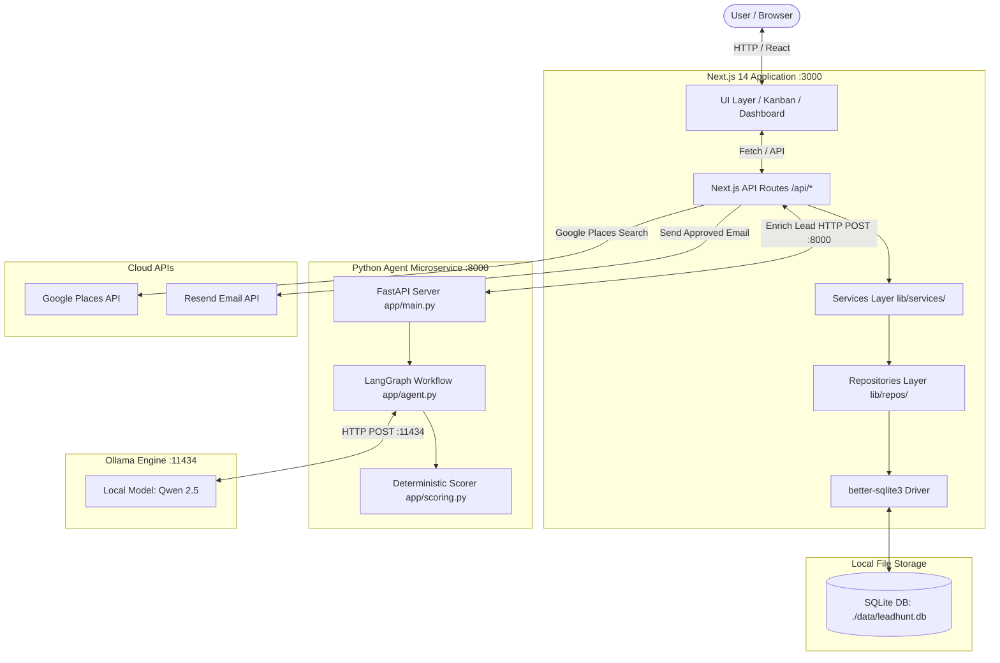
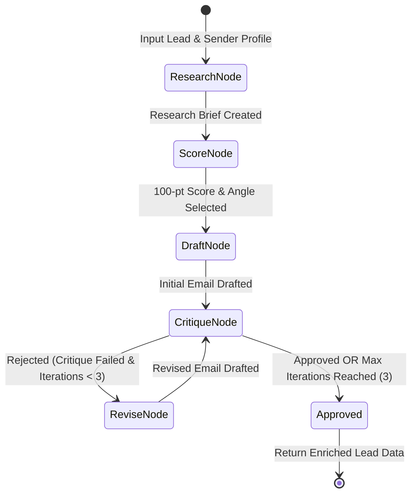
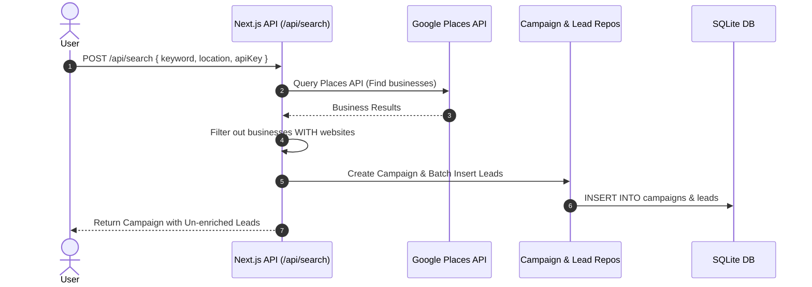
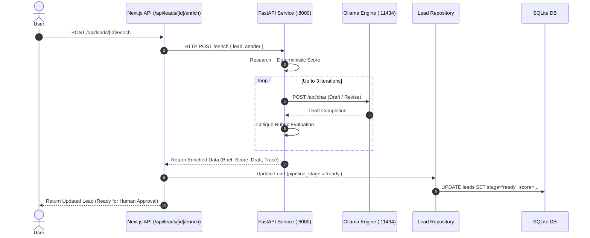
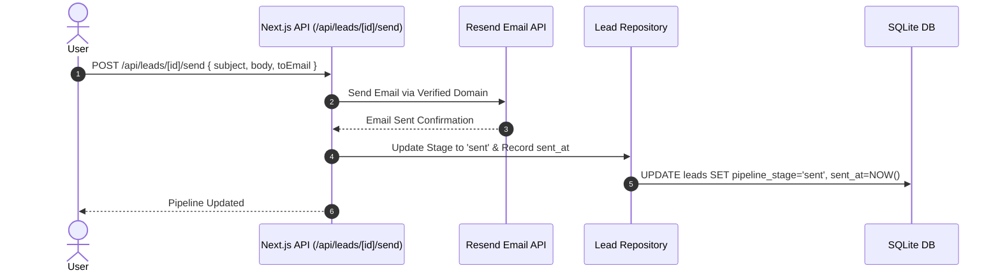
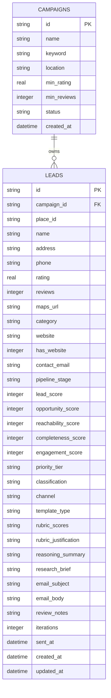

# Architecture Specification: Lead Hunter Platform

## 1. System Overview

**Lead Hunter Platform** is a full-stack, local-first lead discovery, intelligence, and email outreach platform designed to identify local businesses operating without a listed website on Google Maps, generate AI-tailored outreach emails using a multi-pass critique agent, and manage leads through a Kanban sales pipeline until human-approved email delivery.

### Tech Stack Matrix

| Layer | Technology | Key Details |
| --- | --- | --- |
| **Frontend & API Host** | Next.js 14 (App Router) | TypeScript, Tailwind CSS, Lucide Icons, Client-side Kanban state |
| **Database** | SQLite (`better-sqlite3`) | Single WAL-mode file database (`./data/leadhunt.db`) with Repository Pattern |
| **AI Agent Microservice** | Python 3.10+ / FastAPI | LangGraph state machine (`agent-service/app/agent.py`) |
| **Local LLM Engine** | Ollama | Runs locally (`http://localhost:11434`), default model `qwen2.5-coder:7b-instruct-q4_K_M` |
| **External APIs** | Google Places API, Resend | Places API for lead discovery; Resend for transactional email sending |

---

## 2. High-Level Architecture Diagram



---

## 3. Layered Architecture (Next.js Application)

The Next.js backend strictly follows a layered Clean Architecture pattern (`API → Services → Repositories → Storage`):

```
┌─────────────────────────────────────────────────────────────┐
│                 API Layer (app/api/*)                       │
│ Handles HTTP requests, parses payloads, maps errors         │
└──────────────────────────────┬──────────────────────────────┘
                               │
┌──────────────────────────────▼──────────────────────────────┐
│             Service Layer (lib/services/*)                  │
│ Business logic, domain rules, API orchestrations             │
└──────────────────────────────┬──────────────────────────────┘
                               │
┌──────────────────────────────▼──────────────────────────────┐
│          Repository Layer (lib/repositories/*)              │
│ Abstract data access, interfaces (LeadRepo, CampaignRepo)   │
└──────────────────────────────┬──────────────────────────────┘
                               │
┌──────────────────────────────▼──────────────────────────────┐
│             Storage Layer (lib/db.ts)                       │
│ Singleton SQLite better-sqlite3 instance with WAL mode      │
└─────────────────────────────────────────────────────────────┘
```

### Modular Components & Responsibilities

- **`lib/db.ts`**: Handles lazy initialization of the SQLite database connection (`./data/leadhunt.db`), enables `WAL` mode and `foreign_keys = ON`, and performs automated schema migrations.
- **`lib/repositories/campaigns.ts` & `leads.ts`**: Provide typed SQL access functions. Hides database-specific SQL queries behind domain repository interfaces, allowing seamless swapping to PostgreSQL.
- **`lib/services/`**:
  - `campaignService.ts`: Business logic for retrieving and modifying campaign state.
  - `leadService.ts`: Operations on leads, pipeline stage transitions, and trigger handlers.
  - `dashboardService.ts`: Aggregates lead counts, score distributions, priority tiers, and conversion rates.
  - `scoringEngine.ts`: Client-side fallback scoring helpers.
- **`lib/agent.ts`**: HTTP client bridge calling the Python FastAPI agent service (`http://127.0.0.1:8000/enrich`).
- **`lib/places.ts`**: Calls Google Places API text/nearby search, extracts business metadata, and filters out businesses that already have a listed website.
- **`lib/email.ts`**: Resend API integration for sending approved cold outreach emails.

---

## 4. AI Agent Microservice Architecture (`agent-service/`)

The email drafting process is delegated to an isolated Python microservice built with **FastAPI** and **LangGraph**.

### LangGraph State Machine



### Graph Nodes Explained

1. **`research_node`**: Compiles business name, category, rating, review count, and missing website status into a standardized research brief.
2. **`score_node`**: Executes a deterministic, 100-point rubric in `app/scoring.py` (0-LLM token usage):
   - **Metrics evaluated**: Rating quality (20 pts), Review volume (15 pts), Premium positioning (15 pts), Digital presence (15 pts), Contact availability (10 pts), Brand strength (10 pts), Market opportunity (10 pts), Weakness exposure (5 pts), Ease of closing (5 pts).
   - **Buyer Persona Classifications**: `LUXURY_PREMIUM`, `DIGITAL_WEAKNESS_OPPORTUNITY`, `HIGH_POTENTIAL_GROWTH`, `REPUTATION_RISK`, `COMPETITOR_PRESSURE_TARGET`, `GENERAL_OUTREACH`.
   - **Outreach Angle Selection**: Selects a tailored narrative template (`luxury_pitch`, `social_media_weakness_pitch`, etc.).
3. **`draft_node`**: Calls the local Ollama LLM (`/api/chat`) to write a short (<120 words), hyper-specific cold email.
4. **`critique_node`**: Evaluates the drafted email against a 4-point rubric (references true business data, states missing website, clear CTA, <120 words).
5. **`revise_node`**: If critique fails, rewrites the email addressing specific feedback. Loops back to `critique_node` with an **iteration cap of 3**, ensuring bounded execution time and zero runaway token loops.

---

## 5. System Workflows & Data Flows

### A. Lead Search & Discovery Workflow



### B. AI Enrichment & Drafting Workflow



### C. Human-in-the-Loop Send Workflow



---

## 6. Database Schema & Data Model

The database relies on two primary entities: **`campaigns`** and **`leads`**.



### Pipeline Lifecycle Stages (`pipeline_stage`)
- **`new`**: Newly discovered business without a website.
- **`drafting`**: AI enrichment in progress.
- **`ready`**: AI scorecard and email draft generated; awaiting human approval.
- **`sent`**: Email sent via Resend API.
- **`won`**: Client converted / deal closed.
- **`archived`**: Lead hidden or marked irrelevant.

---

## 7. Key Architecture Guarantees & Security

1. **Human-in-the-Loop Safeguard**: AI agents draft emails but **never send emails automatically**. Dragging a lead to "Sent" or clicking Send requires explicit human confirmation.
2. **Zero Cloud LLM API Cost**: LLM generation runs completely locally via Ollama (`http://localhost:11434`), eliminating API token expenses.
3. **Database Portability**: Repositories operate on domain interfaces. Swapping SQLite for PostgreSQL only requires creating a `PostgresLeadRepository` without changing services or API controllers.
4. **Resilience & Local Persistence**: State persists instantly in SQLite WAL mode. Web page refreshes or process restarts do not lose discovered leads or generated drafts.
