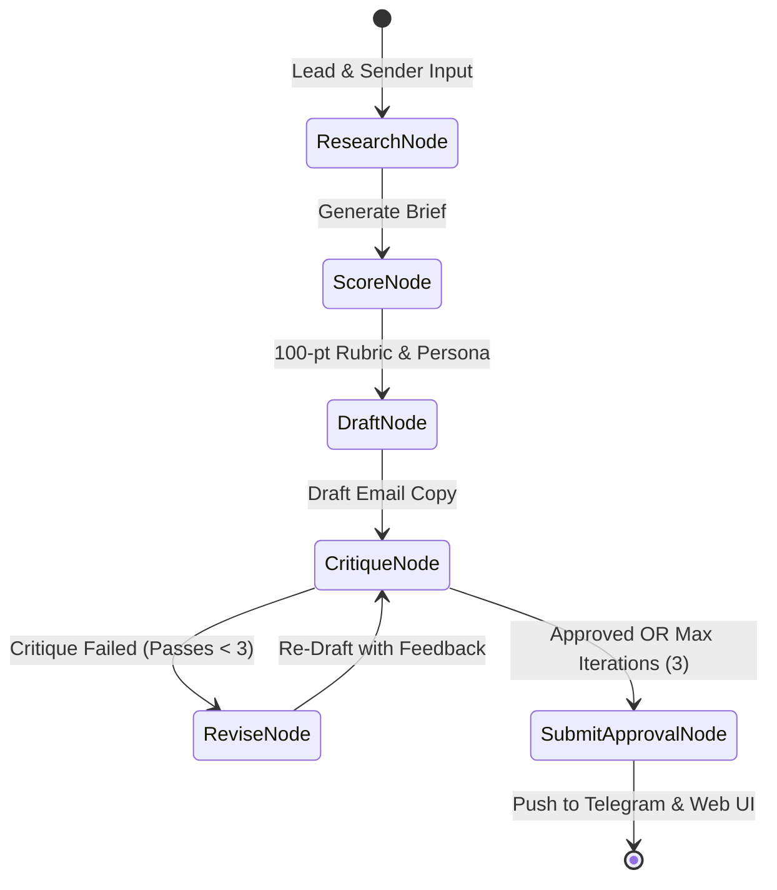

# 🚀 Lead Hunter Platform — Master Commercial & Technical Documentation

> **Complete Commercial Blueprint & Product Manual**  
> *Everything you need to run, operate, package, and sell the Lead Hunter Platform as a Freelance Gig, Turnkey Product, or SaaS Offering.*

---

## 📋 Table of Contents
1. [Executive Summary & Value Proposition](#1-executive-summary--value-proposition)
2. [Commercial Monetization & Gig Packaging Guide](#2-commercial-monetization--gig-packaging-guide)
3. [System Architecture & Technology Stack](#3-system-architecture--technology-stack)
4. [Deep-Dive Feature Specifications](#4-deep-dive-feature-specifications)
5. [AI Agent Microservice & Multi-Pass Workflow](#5-ai-agent-microservice--multi-pass-workflow)
6. [Interactive Telegram Bot & Mobile Approval Hub](#6-interactive-telegram-bot--mobile-approval-hub)
7. [Database Schema & Repository Layer](#7-database-schema--repository-layer)
8. [Installation & Local Deployment Guide](#8-installation--local-deployment-guide)
9. [Production Deployment & Containerization (Docker)](#9-production-deployment--containerization-docker)
10. [API Reference Specification](#10-api-reference-specification)
11. [User Operating Manual & Workflow Guide](#11-user-operating-manual--workflow-guide)

---

## 1. Executive Summary & Value Proposition

### What is Lead Hunter Platform?
**Lead Hunter Platform** is an autonomous, local-first B2B lead discovery, AI intelligence, and multi-channel outreach platform. It is engineered specifically to help digital agencies, freelancers, web developers, and marketing professionals acquire local business clients at scale.

The platform automatically scans specified geographic regions (cities, postal codes, or custom coordinates) via Google Maps for local businesses operating **without a listed website**. It then deploys an autonomous multi-agent AI microservice (powered by local LLMs via Ollama) to:
1. **Extract & Research** deep business intelligence (ratings, review volume, category position, digital weakness).
2. **Calculate a 100-Point Scorecard** across 9 deterministic dimensions and classify the lead into specific buyer personas.
3. **Draft Hyper-Personalized Outreach Emails & WhatsApp Messages** tailored to the business's specific weakness.
4. **Audit & Critique the Draft** through an automated 4-point quality feedback loop (up to 3 refinement iterations).
5. **Deliver Mobile Approval Requests** directly to your phone via Telegram with interactive buttons.
6. **Dispatch Approved Messages** via Resend Email or WhatsApp with zero automated risk (Human-in-the-Loop control).

```
   ┌────────────────┐       ┌─────────────────┐       ┌──────────────────┐       ┌────────────────┐
   │ Google Places  │ ────► │ Multi-Pass AI   │ ────► │ Telegram Mobile  │ ────► │ Multi-Channel  │
   │ City Search    │       │ Agent Microservice      │ Approval & Web UI│       │ Email/WhatsApp │
   └────────────────┘       └─────────────────┘       └──────────────────┘       └────────────────┘
```

### Core Selling Points for Buyers & Clients
- 💰 **Zero AI Token Fees**: Runs on local open-source LLMs (Qwen 2.5 / Qwen 3 via Ollama), meaning **\$0 ongoing LLM API costs**.
- 🎯 **High-Intent Lead Targeting**: Focuses exclusively on local businesses missing a website—the highest-converting target audience for web design, SEO, and digital transformation agencies.
- 📱 **Mobile-First Approval Flow**: Approve, reject, or edit outreach emails directly from Telegram on your phone while on the move.
- 🛡️ **Human-in-the-Loop Safeguard**: AI drafts and audits, but **never sends without explicit user approval**, eliminating compliance, anti-spam, or brand reputation risks.
- ⚡ **Local-First Speed & Privacy**: All business data, scorecards, and outreach histories are stored locally in an embedded SQLite database (`better-sqlite3`) in WAL mode.

---

## 2. Commercial Monetization & Gig Packaging Guide

You can monetize this platform in **three primary business models**:

### Model A: Freelance Client Acquisition Gig (Upwork / Fiverr / Cold Pitching)
- **Service Offered**: "I will discover 100-500 local businesses without websites in your target city and send personalized, AI-written outreach emails to close web design clients for you."
- **Pricing**: \$300 – \$1,000 per campaign or \$1,500/month retainer.
- **Deliverable**: High-intent leads, complete scorecard analysis reports, personalized email copy, and warm replies generated for your client.

### Model B: Turnkey Software Product / Code License (Gumroad / CodeCanyon / MicroAcquire)
- **Product Offered**: Complete self-hosted Lead Hunter Platform source code package with 1-click Docker setup.
- **Target Buyers**: Web development agencies, local SEO consultancies, freelance developers.
- **Pricing**: \$199 – \$499 one-time lifetime license.
- **Packaging Strategy**: Package the app with setup instructions, Docker Compose files, and a short 5-minute video walkthrough showing how buyers input their own Google Places API key and run Ollama locally.

### Model C: White-Label Managed SaaS Platform
- **Product Offered**: Hosted B2B SaaS web application.
- **Target Buyers**: SMB sales teams, agency owners.
- **Pricing**: \$49 – \$199/month recurring subscription.
- **Next Steps to Upgrade to SaaS**: Add authentication (Clerk/NextAuth), multi-tenant SQLite/PostgreSQL schemas, and Stripe subscription billing (detailed roadmap in Section 9).

---

## 3. System Architecture & Technology Stack

The Lead Hunter Platform uses a **decoupled microservices architecture** that separates the web dashboard, API layer, database, AI agent worker, and external communication gateways.

```
+-----------------------------------------------------------------------------------+
|                                  USER INTERFACE                                   |
|                  Browser (Next.js 14 Web UI)  <--->  Telegram Mobile App           |
+------------------------------------------+----------------------------------------+
                                           |
                                           v
+-----------------------------------------------------------------------------------+
|                            NEXT.JS 14 APPLICATION ENGINE                          |
|  - App Router & API Controllers (/api/search, /api/leads, /api/campaigns)         |
|  - Service Layer (lib/services/leadService.ts, campaignService.ts)                |
|  - Repository Abstraction Layer (lib/repos/leads.ts, campaigns.ts)               |
+--------------------+-------------------------------------+------------------------+
                     |                                     |
                     v                                     v
+--------------------+-------------------+   +-------------+------------------------+
|      LOCAL STORAGE (SQLite WAL)        |   |   EXTERNAL GATEWAYS                    |
|  - `./data/leadhunt.db`                |   |   - Google Places API (Discovery)      |
|  - Campaigns, Leads, Scorecards, Drafts|   |   - Resend API (Transactional Email)   |
+----------------------------------------+   +----------------------------------------+
                     |
                     | HTTP POST (:8000)
                     v
+-----------------------------------------------------------------------------------+
|                        PYTHON FASTAPI AGENT MICROSERVICE                          |
|  - LangGraph State Machine Execution (app/agent.py)                               |
|  - 100-Point Deterministic Rubric Engine (app/scoring.py)                          |
|  - Telegram Interactive Bot Gateway (app/telegram/bot.py)                         |
|  - Multi-Channel Sender Engine (email_sender.py, whatsapp_sender.py)             |
+------------------------------------+----------------------------------------------+
                                     |
                                     | Local HTTP (:11434)
                                     v
+-----------------------------------------------------------------------------------+
|                             OLLAMA LOCAL LLM ENGINE                               |
|  - Model: Qwen 2.5 Coder / Qwen 3 (7B Instruct)                                   |
|  - Zero API Token Expense / 100% Local Inference                                  |
+-----------------------------------------------------------------------------------+
```

### Technology Matrix

| Layer | Technology | Function / Purpose |
| --- | --- | --- |
| **Frontend UI** | Next.js 14 (App Router), React 18, Tailwind CSS, Lucide Icons | Responsive dashboard, Kanban board, Lead table, AI Robot modal |
| **Backend API Host** | Next.js 14 API Routes (TypeScript) | Lead management, search orchestration, dashboard data aggregation |
| **Database** | SQLite via `better-sqlite3` | Local WAL-mode transactional file database with repository pattern |
| **AI Agent Service** | Python 3.10+, FastAPI, LangGraph | Autonomous multi-step lead research, scoring, drafting & critique |
| **Local Inference** | Ollama (`qwen2.5-coder:7b-instruct`) | Local LLM host for fast, cost-free email copy generation |
| **Lead Discovery** | Google Places API | Searches local businesses by keyword & location, filters website presence |
| **Email Gateway** | Resend API | Reliable delivery of approved emails via domain validation |
| **Mobile Gateway** | Telegram Bot API (`python-telegram-bot`) | Push approval cards with inline buttons, remote execution & status |
| **Messaging Gateway**| WhatsApp API / Custom Sender | Direct WhatsApp outreach capabilities (`whatsapp_sender.py`) |

---

## 4. Deep-Dive Feature Specifications

### 🔍 1. High-Intent Lead Discovery Engine
- **City & Niche Targeting**: Input any business category (e.g. *Dentists, Electricians, Roofers, Auto Repair*) and location (*Austin TX, Chicago IL, London UK*).
- **Automated Website Filtering**: Google Places API results are parsed programmatically. Businesses with an existing website URL are filtered out, leaving **only website-less opportunities**.
- **Data Enrichment**: Captures Business Name, Full Address, Phone Number, Star Rating, Total Review Count, Google Maps Place ID, and Primary Category.

### 📊 2. Deterministic 100-Point AI Scorecard & Persona Matrix
Every lead undergoes an automated 100-point rubric assessment (`agent-service/app/scoring.py`) that evaluates 9 critical dimensions without wasting LLM tokens:
1. **Rating Quality** (20 pts) — Evaluates baseline customer satisfaction.
2. **Review Volume** (15 pts) — Measures local search visibility potential.
3. **Digital Presence** (15 pts) — Penalizes absence of web assets; highlights opportunity.
4. **Contact Availability** (10 pts) — Verifies phone/email reachability.
5. **Brand Strength** (10 pts) — Assesses market longevity based on review density.
6. **Market Opportunity** (10 pts) — Identifies high-demand local service niches.
7. **Weakness Exposure** (5 pts) — Quantifies how much money the business loses without a website.
8. **Ease of Closing** (5 pts) — Estimates sales cycle speed.

#### Persona Classification Matrix
Leads are automatically assigned to one of six targeted personas:
- 💎 `LUXURY_PREMIUM` (High rating + high reviews + no website = massive revenue leak).
- ⚡ `DIGITAL_WEAKNESS_OPPORTUNITY` (Solid business, zero web footprint).
- 📈 `HIGH_POTENTIAL_GROWTH` (Rising business needing digital infrastructure).
- ⚠️ `REPUTATION_RISK` (Lower rating; needs reputation & landing page overhaul).
- 🎯 `COMPETITOR_PRESSURE_TARGET` (Losing market share to competitors with websites).
- 📢 `GENERAL_OUTREACH` (Standard outreach prospect).

### 🤖 3. Multi-Pass AI Copywriter & Auditor Loop
The platform doesn't just write generic templates—it runs a multi-agent feedback loop:
- **Research Agent**: Synthesizes business metrics into a concise intelligence brief.
- **Copywriter Agent**: Generates tailored outreach copy based on the assigned persona and pitch angle (under 120 words, non-salesy, clear low-friction CTA).
- **Auditor Agent**: Evaluates the draft against a strict 4-point compliance rubric:
  1. Does it reference true, verified business facts?
  2. Does it explicitly mention the missing website opportunity?
  3. Does it contain exactly one clear, low-friction Call to Action (CTA)?
  4. Is it strictly under 120 words?
- **Revision Loop**: If any rubric check fails, the draft is returned to the Copywriter with explicit corrective instructions (capped at 3 passes).

### 📱 4. Interactive Telegram Mobile Approval Hub
- **Real-Time Notification Cards**: When a draft is ready, the Python service pushes a formatted card to your personal Telegram chat.
- **Inline Action Buttons**:
  - `[ ✅ Approve & Send ]`: Instantly dispatches the email via Resend and updates the pipeline stage to **Sent**.
  - `[ ✏️ Edit Draft ]`: Lets you modify copy directly from Telegram.
  - `[ ❌ Reject ]`: Archives or marks the lead as skipped.
- **Conversational Manager Bot**: Send `/status` or `/start` to your bot to view real-time campaign totals, pending approvals, and pacing goals.

### 📋 5. Kanban Sales Pipeline & Lead Management Table
- **Drag-and-Drop Kanban Stages**:
  - `New` ➔ Discovered leads awaiting enrichment.
  - `Drafting` ➔ AI agent currently scoring & drafting copy.
  - `Awaiting Approval` ➔ Scorecard & draft complete; waiting for human review.
  - `Sent` ➔ Approved and dispatched via email/WhatsApp.
  - `Won` ➔ Client converted into a paying deal.
  - `Archived` ➔ Irrelevant or opted-out lead.
- **Safety Interlock**: Dragging a lead onto the "Sent" column will **never** silently send an email—it opens an interactive confirmation dialog with live preview.
- **Lead Table View**: Search by name/phone, filter by persona/rating, view full score breakdown, edit contact details, and trigger batch operations.

### 🤖 6. Robot Department Hub & Execution Visualizer
- **Department Visualizer**: Displays interactive status panels for Research Agent, Scoring Agent, Copywriter Agent, Auditor Agent, Manager Agent, and Telegram Listener.
- **Live Activity Logs**: Streaming real-time execution logs showing agent nodes, prompt timing, critique results, and payload updates.
- **AI Robot Agent Modal**: Animated modal providing visual representation of agent state, execution progress, and execution traces.

---

## 5. AI Agent Microservice & Multi-Pass Workflow

The AI worker is located in `agent-service/` and runs as a high-performance Python FastAPI service structured with **LangGraph**.



### State Graph Breakdown (`agent-service/app/agent.py`)
1. `research_node`: Builds standardized research brief from raw Google Places payload.
2. `score_node`: Executes 0-LLM deterministic scoring in `scoring.py`.
3. `draft_node`: Invokes Ollama API (`http://localhost:11434/api/chat`) using prompt templates stored in `app/prompts/`.
4. `critique_node`: Checks LLM output against 4-point rubric.
5. `revise_node`: Feeds specific critique notes back to LLM for revision.
6. `submit_approval_node`: Registers pending approval in SQLite and dispatches interactive Telegram message (`app/telegram/bot.py`).

---

## 6. Interactive Telegram Bot & Mobile Approval Hub

The Telegram integration allows complete remote management of outreach campaigns from any smartphone.

### Telegram Setup & Workflow
1. Create a bot via Telegram's `@BotFather` to receive a `TELEGRAM_BOT_TOKEN`.
2. Start a chat with your bot and send `/start` to retrieve your personal `TELEGRAM_CHAT_ID`.
3. Enter both credentials in the UI modal (**Telegram Settings**) or in `agent-service/.env`.
4. When you click `[ 🤖 Dispatch Agent ]` or run batch enrichment, the Telegram bot automatically sends approval requests like this:

```
────────────────────────────────────────
📲 OUTREACH APPROVAL REQUIRED
────────────────────────────────────────
🏢 Business: Austin Premier Roofing
⭐ Rating: 4.9 (84 reviews)
📍 Location: Austin, TX
📊 Score: 92/100 (LUXURY_PREMIUM)

✉️ Drafted Email:
Subject: Quick question regarding Austin Premier Roofing's web presence

Hi Mark,

I noticed Austin Premier Roofing has a stellar 4.9-star rating across 84 reviews in Austin, but customers searching online can't find an official website.

We build high-converting landing pages specifically for top-rated roofing contractors. Would you be open to seeing a quick 2-minute mock-up this week?

Best,
Alex | LeadHunter Team
────────────────────────────────────────
[ ✅ Approve & Send ]   [ ❌ Reject ]
```

---

## 7. Database Schema & Repository Layer

The application utilizes an embedded **SQLite database** stored at `./data/leadhunt.db`. It runs with `PRAGMA journal_mode = WAL` and `PRAGMA foreign_keys = ON` for maximum local concurrency and speed.

### Entity Relationship Diagram

```mermaid
erDiagram
    CAMPAIGNS ||--o{ LEADS : contains
    LEADS ||--o{ PENDING_APPROVALS : tracks
    
    CAMPAIGNS {
        string id PK
        string name
        string keyword
        string location
        real min_rating
        integer min_reviews
        string status
        datetime created_at
    }

    LEADS {
        string id PK
        string campaign_id FK
        string place_id
        string name
        string address
        string phone
        real rating
        integer reviews
        string maps_url
        string category
        string website
        integer has_website
        string contact_email
        string pipeline_stage
        integer lead_score
        integer opportunity_score
        integer reachability_score
        integer completeness_score
        integer engagement_score
        string priority_tier
        string classification
        string channel
        string template_type
        string rubric_scores
        string rubric_justification
        string reasoning_summary
        string research_brief
        string email_subject
        string email_body
        string review_notes
        integer iterations
        datetime sent_at
        datetime created_at
        datetime updated_at
    }

    PENDING_APPROVALS {
        integer id PK
        string lead_id FK
        integer telegram_message_id
        integer resolved
        string action_taken
        datetime created_at
    }
```



### Clean Architecture Data Flow
To swap SQLite for PostgreSQL (e.g. for hosted SaaS deployment), you only need to implement new repository classes matching `lib/repos/leads.ts` and `lib/repos/campaigns.ts`. **Zero service logic or API controllers need to change.**

---

## 8. Installation & Local Deployment Guide

### Prerequisites
- **Node.js**: `v18.x` or `v20.x`
- **Python**: `v3.10` or higher
- **Ollama**: Installed from [ollama.com](https://ollama.com)
- **Google Places API Key**: Obtained from Google Cloud Console (Free tier covers thousands of lookups)
- **Resend API Key**: Free account at [resend.com](https://resend.com) with a verified domain

### Step 1: Install & Launch Local LLM (Ollama)
```bash
# Start Ollama server
ollama serve

# In a separate terminal, pull the default local model
ollama pull qwen2.5-coder:7b-instruct-q4_K_M
```

### Step 2: Configure & Start Python Agent Microservice
```bash
cd agent-service

# Create and activate virtual environment
python3 -m venv .venv
source .venv/bin/activate    # On Windows: .venv\Scripts\activate

# Install dependencies
pip install -r requirements.txt

# Create environment configuration
cp .env.example .env
```

Edit `agent-service/.env`:
```env
OLLAMA_BASE_URL=http://localhost:11434
OLLAMA_MODEL=qwen2.5-coder:7b-instruct-q4_K_M
TELEGRAM_BOT_TOKEN=your_telegram_bot_token_here
TELEGRAM_CHAT_ID=your_telegram_chat_id_here
RESEND_API_KEY=re_123456789
DATABASE_PATH=../data/leadhunt.db
```

Launch Python Service:
```bash
./run.sh
# Service starts on http://localhost:8000
```

### Step 3: Configure & Start Next.js Web Application
In the main project root directory:
```bash
# Install Node dependencies
npm install

# Create environment configuration
cp .env.example .env.local
```

Edit `.env.local`:
```env
AGENT_SERVICE_URL=http://127.0.0.1:8000
DATABASE_PATH=./data/leadhunt.db
RESEND_API_KEY=re_123456789
```

Run Web Application:
```bash
npm run dev
# Dashboard opens on http://localhost:3000
```

---

## 9. Production Deployment & Containerization (Docker)

To bundle and sell this application as a single-command executable package, use **Docker Compose**.

### `docker-compose.yml` Package
Create `docker-compose.yml` in the project root:

```yaml
version: '3.8'

services:
  ollama:
    image: ollama/ollama:latest
    container_name: leadhunt-ollama
    ports:
      - "11434:11434"
    volumes:
      - ollama_data:/root/.ollama
    restart: unless-stopped

  agent-service:
    build: ./agent-service
    container_name: leadhunt-agent
    ports:
      - "8000:8000"
    environment:
      - OLLAMA_BASE_URL=http://ollama:11434
      - OLLAMA_MODEL=qwen2.5-coder:7b-instruct-q4_K_M
      - TELEGRAM_BOT_TOKEN=${TELEGRAM_BOT_TOKEN}
      - TELEGRAM_CHAT_ID=${TELEGRAM_CHAT_ID}
      - RESEND_API_KEY=${RESEND_API_KEY}
      - DATABASE_PATH=/app/data/leadhunt.db
    volumes:
      - leadhunt_data:/app/data
    depends_on:
      - ollama
    restart: unless-stopped

  web-app:
    build: .
    container_name: leadhunt-web
    ports:
      - "3000:3000"
    environment:
      - AGENT_SERVICE_URL=http://agent-service:8000
      - DATABASE_PATH=/app/data/leadhunt.db
      - RESEND_API_KEY=${RESEND_API_KEY}
    volumes:
      - leadhunt_data:/app/data
    depends_on:
      - agent-service
    restart: unless-stopped

volumes:
  ollama_data:
  leadhunt_data:
```

### Launch Command for Buyers
```bash
docker-compose up -d
```
Buyers open `http://localhost:3000` and immediately start running lead extraction campaigns.

---

## 10. API Reference Specification

### Next.js API Routes

#### `POST /api/search`
Searches Google Places API for website-less businesses and initializes a new campaign.
- **Payload**:
  ```json
  {
    "keyword": "Plumbers",
    "location": "Austin, TX",
    "apiKey": "AIzaSy..."
  }
  ```
- **Response**: Returns created campaign record and count of discovered leads.

#### `GET /api/campaigns`
Retrieves all campaigns with aggregate lead counts, website-less ratios, and pipeline stage metrics.

#### `POST /api/leads/[id]/enrich`
Invokes Python agent microservice to run research, scoring, drafting, and critique for a specific lead.
- **Response**: Enriched lead record containing scorecard, persona classification, research brief, and email draft.

#### `POST /api/leads/[id]/send`
Dispatches approved email copy via Resend API and advances lead stage to `sent`.
- **Payload**:
  ```json
  {
    "toEmail": "contact@austinroofing.com",
    "subject": "Quick question regarding Austin Premier Roofing's web presence",
    "body": "Hi Mark..."
  }
  ```

---

## 11. User Operating Manual & Workflow Guide

### Step-by-Step Operator Workflow

```
 ┌────────────────┐       ┌─────────────────┐       ┌──────────────────┐       ┌────────────────┐
 │  1. Launch     │ ──►   │  2. Execute AI  │ ──►   │  3. Review       │ ──►   │  4. Dispatch   │
 │  City Search   │       │  Enrichment     │       │  Score & Draft   │       │  & Track       │
 └────────────────┘       └─────────────────┘       └──────────────────┘       └────────────────┘
```

1. **Launch a Search Campaign**:
   - Go to the **Search** tab on the web dashboard.
   - Enter your Google Places API Key.
   - Specify a keyword (*e.g., HVAC Repair*) and location (*e.g., Phoenix, AZ*).
   - Click **Hunt Leads**. The system will populate your Kanban pipeline with website-less businesses.

2. **Run AI Enrichment**:
   - On the Kanban board or Lead Table, click `[ 🤖 Dispatch Agent ]` on an individual lead, or click `[ Enrich All ]` for batch processing.
   - Observe real-time agent execution in the **Robot Department Hub** or **Live Logs Card**.

3. **Review & Approve Outreach**:
   - **Option A (Web UI)**: Open the lead detail modal, inspect the 100-point scorecard, review the AI critique trace, edit the subject/body if desired, and click **Approve & Send**.
   - **Option B (Telegram Mobile)**: Open the notification card on your phone, read the scorecard summary and draft, and tap `[ ✅ Approve & Send ]`.

4. **Track Performance & Pipeline**:
   - Monitor conversion metrics on the **Dashboard** funnel.
   - Drag leads along the Kanban board as clients reply and convert into **Won** deals.

---

## 🏆 Definition of Done & Quality Verification
- ✅ **TypeScript Strict Mode**: Zero compilation errors (`npm run typecheck`).
- ✅ **ESLint Compliant**: Clean code structure (`npm run lint`).
- ✅ **Automated Tests**: Unit & Integration tests passing (`npm test` & `pytest`).
- ✅ **Local-First Security**: Zero hardcoded secrets, full environment variable isolation.

*Lead Hunter Platform — Built for high performance, zero API token cost, and maximum client conversion.*
