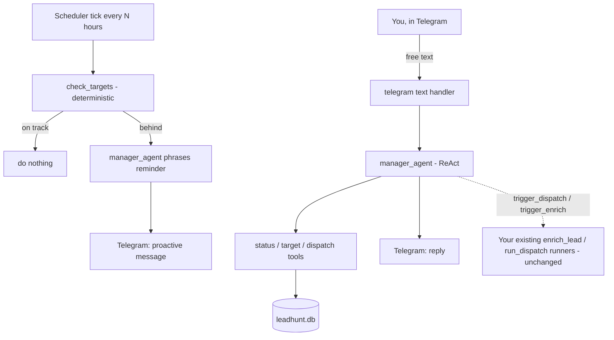

# Manager Agent — Implementation Guide

## Scope, as agreed

- The manager does **not** re-judge lead or draft quality — `ScoreNode` and
  `EvalDraftNode` stay the only quality judges, unchanged.
- The manager **is** a target/goal tracker: you tell it a target and a
  deadline, it watches actual progress against that deadline continuously,
  and it proactively nags you in Telegram when you're falling behind —
  "by this date you should reach X, we're not there yet, approve the
  pending ones."
- It's also the same conversational status/dispatcher agent from the
  feasibility doc — chat with it, it tells you what's queued, and it can
  trigger `enrich_lead` / `run_dispatch` on request.
- ChromaDB: skipped for now, per your call. Chat memory uses LangGraph's
  own checkpointer (backed by your existing SQLite) instead — that alone
  gets you "remembers our last conversation," which was the actual goal.
  If you later find yourself wanting semantic recall over rejection
  feedback specifically, that's a small, isolated addition — nothing here
  needs to change to add it.
- Model: manager runs on the general-purpose `qwen2.5:7b-instruct` you're
  pulling, kept separate from `qwen2.5-coder` which stays on drafting.

Two new runtime pieces, both small:

1. **A deterministic target checker** — plain Python, no LLM, runs on a
   timer. Decides *whether* to nag.
2. **A ReAct manager agent** — LLM + tools, runs on demand from chat, and
   also gets called by the ticker to *phrase* the nag once the checker
   already decided one is due.



---

## 1. New table: `targets`

One table, plain SQL, no new subsystem.

```sql
CREATE TABLE targets (
    id            INTEGER PRIMARY KEY AUTOINCREMENT,
    label         TEXT NOT NULL,          -- "Send 50 outreach emails this week"
    target_stage  TEXT NOT NULL,          -- which leads.stage counts toward this, e.g. 'sent'
    target_count  INTEGER NOT NULL,
    period_start  TEXT NOT NULL,          -- ISO date
    deadline      TEXT NOT NULL,          -- ISO date
    status        TEXT NOT NULL DEFAULT 'active',  -- active | done | missed
    created_at    TEXT NOT NULL DEFAULT (datetime('now'))
);
```

You set targets by chatting with the manager ("set a target: 50 sent by
Friday") — that's one of its tools, `set_target`, below. No admin UI needed.

## 2. The deterministic checker — `app/manager/targets.py`

This is the part that decides *whether* today is a "behind schedule" day.
No LLM in this function, on purpose — the pace math should never be
ambiguous or hallucinated.

```python
"""Deterministic target-progress checks. No LLM calls in this file."""
from __future__ import annotations
from datetime import date, datetime
from app.db import get_connection  # your existing WAL SQLite helper

def _parse(d: str) -> date:
    return datetime.strptime(d, "%Y-%m-%d").date()

def check_targets(today: date | None = None) -> list[dict]:
    """Returns one entry per active target, with pace status.

    behind = actual count is under the linearly-expected count for how much
    of the period has elapsed. Simple on purpose — you can swap in a
    smarter pacing curve later without touching anything else.
    """
    today = today or date.today()
    conn = get_connection()
    cur = conn.execute("SELECT * FROM targets WHERE status = 'active'")
    results = []

    for row in cur.fetchall():
        start, end = _parse(row["period_start"]), _parse(row["deadline"])
        total_days = max((end - start).days, 1)
        elapsed_days = max((today - start).days, 0)
        pace = min(elapsed_days / total_days, 1.0)
        expected = round(row["target_count"] * pace)

        actual = conn.execute(
            "SELECT COUNT(*) AS n FROM leads WHERE stage = ? AND updated_at >= ?",
            (row["target_stage"], row["period_start"]),
        ).fetchone()["n"]

        results.append({
            "id": row["id"],
            "label": row["label"],
            "target_count": row["target_count"],
            "actual": actual,
            "expected_by_now": expected,
            "deadline": row["deadline"],
            "days_left": (end - today).days,
            "behind": actual < expected,
            "overdue": today > end and actual < row["target_count"],
        })
    return results
```

## 3. Manager's tools — `app/manager/tools.py`

Read-only status tools, the two dispatch triggers (with the concurrency
guard flagged in the feasibility doc), and `set_target`. Nothing here
touches scoring, drafting, or approval logic — it only calls your existing
runners as opaque functions.

```python
from __future__ import annotations
from app.db import get_connection
from app.graphs.enrichment_graph import enrich_lead
from app.graphs.dispatch_graph import run_dispatch
from app.manager.targets import check_targets

def get_pipeline_summary() -> dict:
    """Count of leads per pipeline stage right now."""
    conn = get_connection()
    rows = conn.execute("SELECT stage, COUNT(*) AS n FROM leads GROUP BY stage").fetchall()
    return {r["stage"]: r["n"] for r in rows}

def get_pending_approvals() -> list[dict]:
    """Leads currently sitting with a human, waiting on a Telegram decision."""
    conn = get_connection()
    rows = conn.execute(
        "SELECT lead_id, created_at FROM pending_approvals WHERE resolved = 0"
    ).fetchall()
    return [dict(r) for r in rows]

def get_target_progress() -> list[dict]:
    """Deterministic pace-vs-target check — same function the scheduler uses."""
    return check_targets()

def set_target(label: str, target_stage: str, target_count: int,
                period_start: str, deadline: str) -> dict:
    """Create a new target the manager will track and nag about.
    Dates as YYYY-MM-DD. target_stage must match a real leads.stage value."""
    conn = get_connection()
    conn.execute(
        "INSERT INTO targets (label, target_stage, target_count, period_start, deadline) "
        "VALUES (?, ?, ?, ?, ?)",
        (label, target_stage, target_count, period_start, deadline),
    )
    conn.commit()
    return {"created": label, "deadline": deadline}

def trigger_enrich(lead_id: str) -> dict:
    """Kick off enrichment for a lead that hasn't been scored/drafted yet."""
    conn = get_connection()
    row = conn.execute("SELECT stage FROM leads WHERE id = ?", (lead_id,)).fetchone()
    if row is None:
        return {"error": "no such lead"}
    if row["stage"] not in ("new",):
        return {"error": f"lead is already at stage '{row['stage']}' — refusing to re-enrich"}
    enrich_lead(lead_id)
    return {"lead_id": lead_id, "status": "enrichment started"}

def trigger_dispatch(lead_id: str) -> dict:
    """Kick off the review & dispatch flow for a lead that's ready."""
    conn = get_connection()
    row = conn.execute("SELECT stage FROM leads WHERE id = ?", (lead_id,)).fetchone()
    if row is None:
        return {"error": "no such lead"}
    if row["stage"] not in ("ready", "drafted"):
        return {"error": f"lead is at stage '{row['stage']}' — not safe to dispatch again"}
    run_dispatch(lead_id)
    return {"lead_id": lead_id, "status": "dispatch started"}
```

## 4. The agent itself — `app/manager/agent.py`

Plain `langgraph.prebuilt.create_react_agent` — the standard prebuilt ReAct
agent already inside `langgraph`, which you already depend on. No new
framework, no subagents, no filesystem tooling — those are all things
`deepagents` adds that this job doesn't need.

```python
from langchain_ollama import ChatOllama
from langgraph.prebuilt import create_react_agent
from langgraph.checkpoint.sqlite import SqliteSaver

from app.manager.tools import (
    get_pipeline_summary, get_pending_approvals, get_target_progress,
    set_target, trigger_enrich, trigger_dispatch,
)

SYSTEM_PROMPT = """You are the operations manager for a lead-outreach pipeline.
You do not judge lead quality or draft quality — that's already handled
elsewhere. Your job is:

1. Answer questions about pipeline status and progress toward targets, using
   your tools — never guess numbers, always call a tool for anything factual.
2. When asked to set a target, confirm the stage, count, and deadline back
   before calling set_target.
3. When asked to trigger enrichment or dispatch for a lead, do it, then
   report the result plainly. If a tool refuses (e.g. lead already running),
   relay that reason, don't retry silently.
4. When given a target-progress report and asked to write a reminder, be
   direct and specific: name the target, the deadline, how far behind, and
   what's currently blocking it (e.g. N pending approvals) — like a manager
   flagging a real deadline, not a generic notification.

Never approve or send anything yourself. Sending still requires the human
approval step in the dispatch graph, unchanged.
"""

_checkpointer = SqliteSaver.from_conn_string("data/manager_memory.db")

manager_agent = create_react_agent(
    model=ChatOllama(model="qwen2.5:7b-instruct", temperature=0.3),
    tools=[get_pipeline_summary, get_pending_approvals, get_target_progress,
           set_target, trigger_enrich, trigger_dispatch],
    prompt=SYSTEM_PROMPT,
    checkpointer=_checkpointer,
)

def chat(message: str, chat_id: str) -> str:
    """One turn of conversation, remembered per Telegram chat_id."""
    result = manager_agent.invoke(
        {"messages": [{"role": "user", "content": message}]},
        config={"configurable": {"thread_id": f"manager-{chat_id}"}},
    )
    return result["messages"][-1].content
```

`SqliteSaver` gives you conversation memory ("remembers what we discussed
yesterday") for free, backed by a small SQLite file — this is the thing
ChromaDB was reached for; it isn't needed for plain conversation continuity.

## 5. The scheduler tick — `app/manager/scheduler.py`

Runs `check_targets()` (no LLM) on a timer; only calls the LLM agent to
*phrase* a message when there's actually something behind. Simplest
correct option: `APScheduler` inside your existing FastAPI app's lifespan,
since you're already running FastAPI continuously — no separate cron
process to manage.

```python
from apscheduler.schedulers.background import BackgroundScheduler
from app.manager.targets import check_targets
from app.manager.agent import manager_agent
from app.telegram.bot import send_message  # plain text send, not the approval keyboard

CEO_CHAT_ID = "..."  # from your existing Telegram config

def tick():
    behind = [t for t in check_targets() if t["behind"] or t["overdue"]]
    if not behind:
        return

    result = manager_agent.invoke(
        {"messages": [{
            "role": "user",
            "content": f"Write a short, direct Telegram reminder about these "
                       f"targets that are behind schedule: {behind}. "
                       f"Include what's blocking progress if you can check "
                       f"pending approvals.",
        }]},
        config={"configurable": {"thread_id": "manager-scheduler"}},
    )
    send_message(CEO_CHAT_ID, result["messages"][-1].content)

def start_scheduler():
    sched = BackgroundScheduler()
    sched.add_job(tick, "interval", hours=4)  # tune to taste
    sched.start()
    return sched
```

Wire `start_scheduler()` into your FastAPI `lifespan` startup alongside
whatever you already do there.

## 6. Telegram free-text handler

Your existing `app/telegram/bot.py` already handles `callback_query`
updates (Approve/Reject buttons). Add one more branch for plain messages:

```python
from app.manager.agent import chat as manager_chat

async def on_message(update, context):
    if update.message and update.message.text:
        reply = manager_chat(update.message.text, chat_id=str(update.message.chat_id))
        await update.message.reply_text(reply)
```

That's the whole "chat with him" surface — same bot, same chat, buttons for
approvals, free text for everything else.

---

## What this gives you day to day

- You message the bot: *"where are we this week?"* → manager calls
  `get_target_progress` + `get_pipeline_summary`, answers with real numbers.
- Every 4 hours, if a target's behind pace, it messages you first —
  unprompted — naming the target, the deadline, and what's stuck.
- You say *"dispatch lead 482"* → it calls `trigger_dispatch`, tells you
  what happened, refuses cleanly if that lead's already running.
- It never scores a lead, never rewrites a draft, never approves a send.
  Those stay exactly as documented in `agent_system_documentation.md`.

## Setup checklist

1. `ollama pull qwen2.5:7b-instruct`
2. Add the `targets` table (migration above).
3. Add `app/manager/{targets.py, tools.py, agent.py, scheduler.py}`.
4. `pip install langchain-ollama apscheduler` (both small, no new heavy deps).
5. Wire `start_scheduler()` into FastAPI's lifespan.
6. Add the `on_message` branch to your Telegram bot.
7. Set your first target by chatting with the bot, e.g.: *"set a target:
   30 sent by next Friday, label it weekly outreach."*